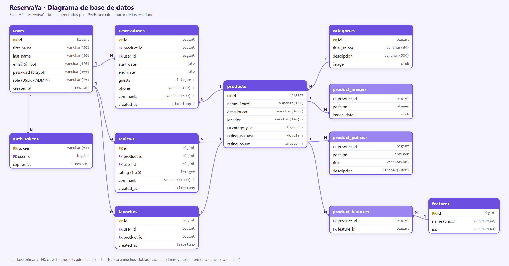
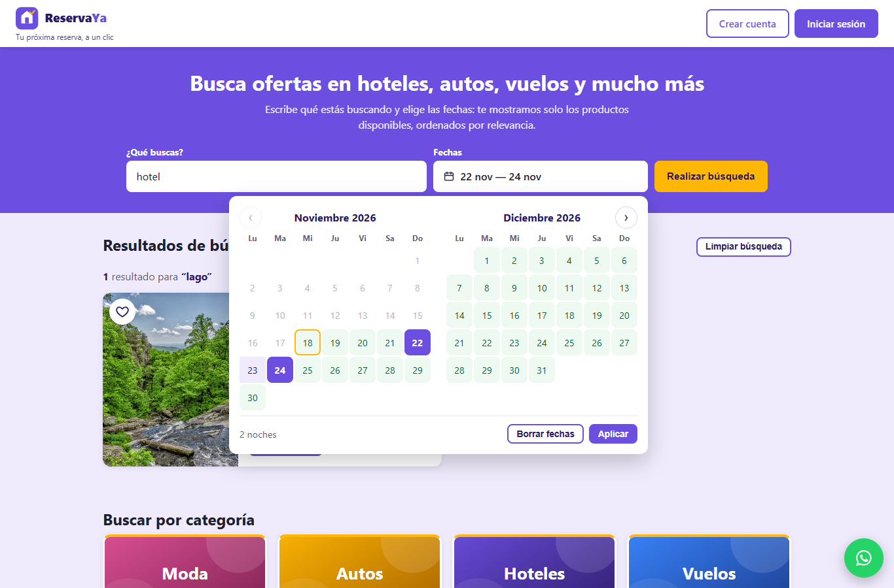
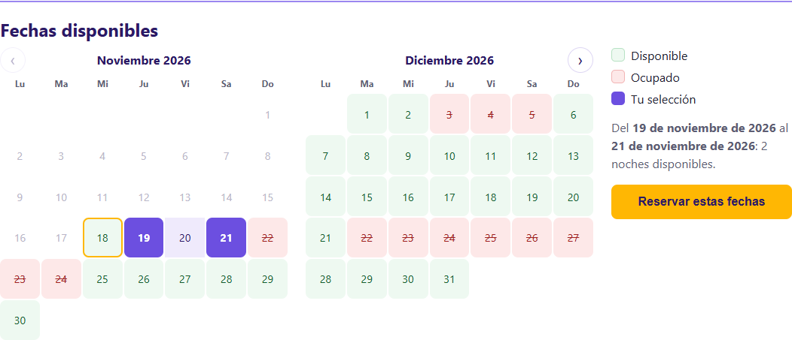
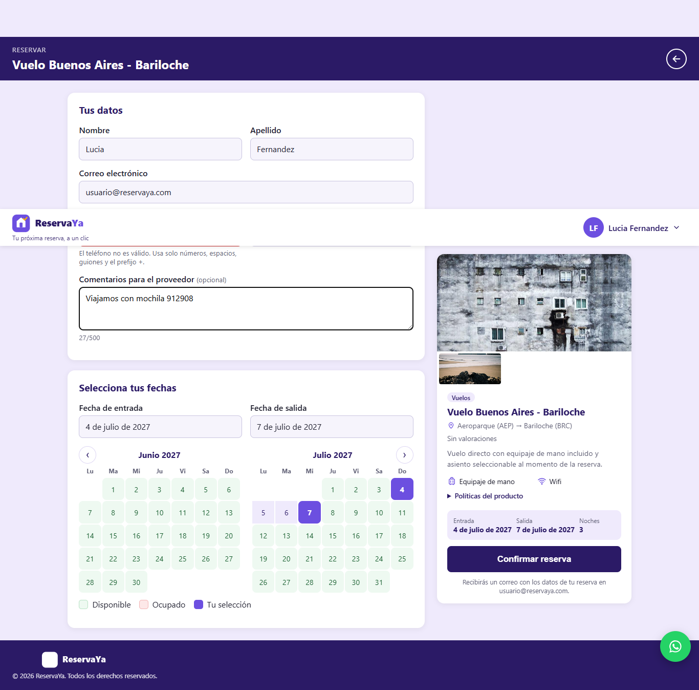
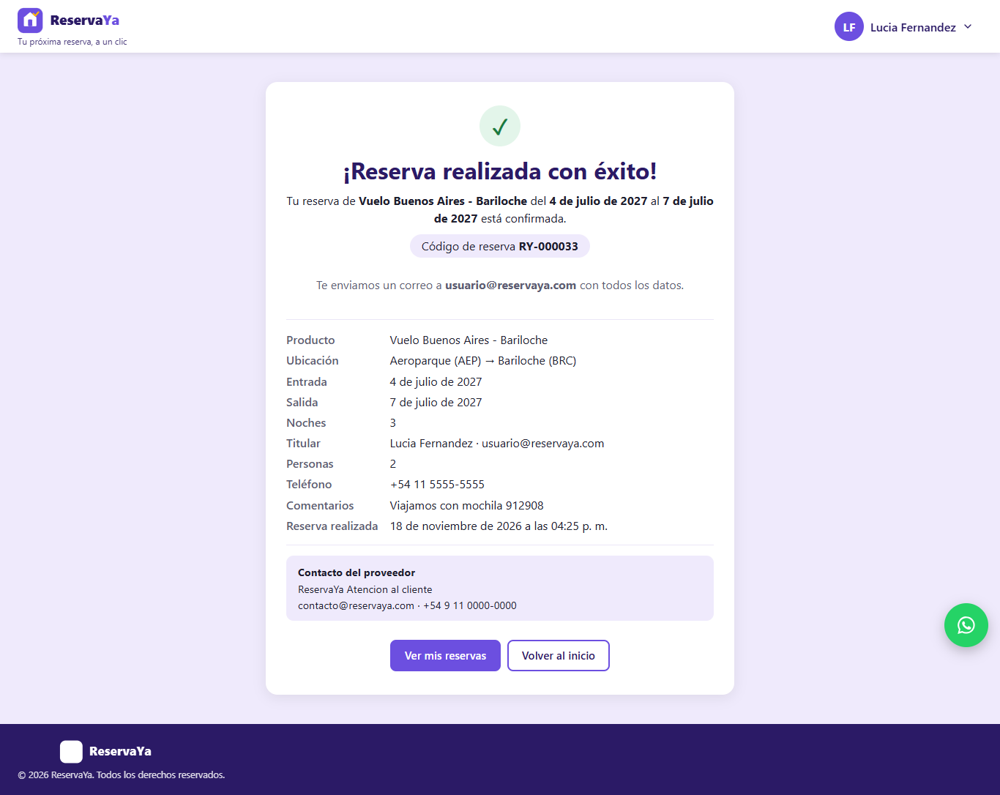
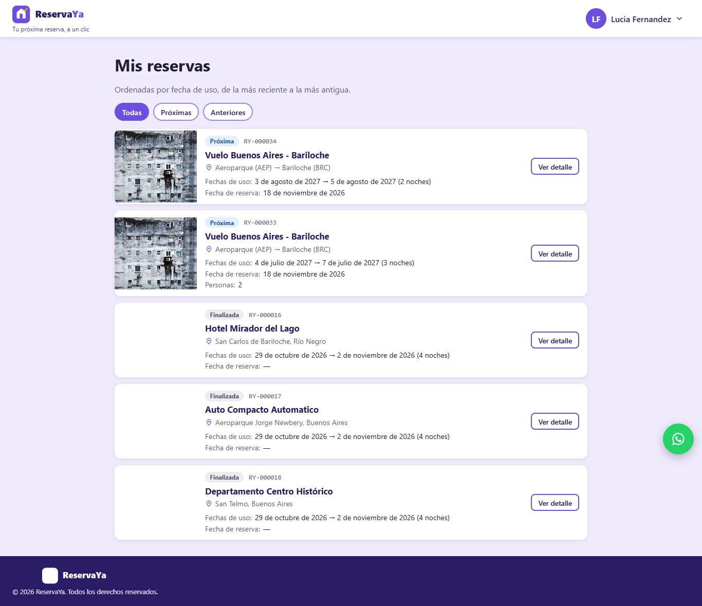
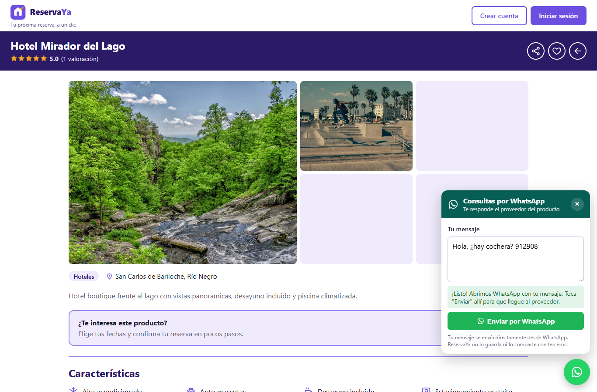
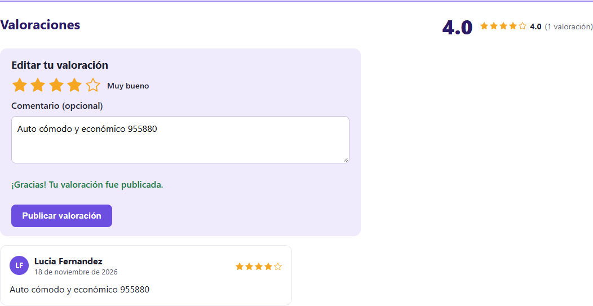
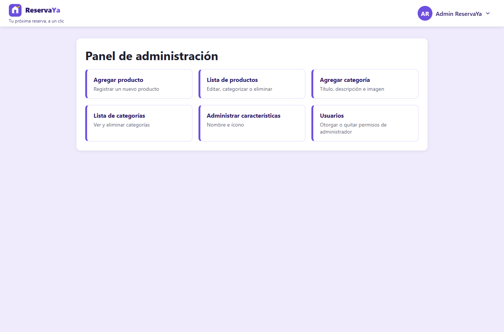

# 🏨 ReservaYa

**ReservaYa** es una aplicación web para buscar y reservar hoteles, vuelos, alquileres de moda y autos. Los usuarios encuentran productos por texto y fechas, ven la disponibilidad en un calendario, reservan en pocos pasos y reciben la confirmación por correo. Los administradores gestionan el catálogo desde un panel.

Proyecto final del **Desafío Professional Developer** de Digital House.

    

---

## 📑 Contenido

- [Funcionalidades](#-funcionalidades)
- [Tecnologías](#-tecnologías)
- [Instalación local](#-instalación-local)
- [Configuración del backend](#-configuración-del-backend)
- [Configuración del frontend](#-configuración-del-frontend)
- [Endpoints de la API](#-endpoints-de-la-api)
- [Diagrama de base de datos](#-diagrama-de-base-de-datos)
- [Testing](#-testing)
- [Deploy](#-deploy)
- [Capturas de pantalla](#-capturas-de-pantalla)
- [Decisiones técnicas](#-decisiones-técnicas)
- [Documentación por sprint](#-documentación-por-sprint)

---

## ✨ Funcionalidades

| Área | Qué permite |
|---|---|
| Catálogo | Home con recomendaciones aleatorias, listado paginado, detalle con galería, características, políticas y ubicación |
| Búsqueda | Texto con autocompletado, rango de fechas con calendario doble, resultados por relevancia que excluyen productos ocupados, filtro por categorías |
| Usuarios | Registro con validaciones, inicio y cierre de sesión, avatar con iniciales, correo de bienvenida |
| Reservas | Disponibilidad en el detalle, página de reserva con datos del usuario y opcionales, confirmación, historial "Mis reservas" y correo con los datos de la reserva |
| Interacción | Favoritos, valoraciones con estrellas (solo con reserva finalizada), compartir en redes, chat por WhatsApp |
| Administración | Productos (alta, edición, baja, categoría, características, políticas), categorías, características con ícono y permisos de administrador |

---

## 🛠 Tecnologías

### Backend
- **Java 17**
- **Spring Boot 3.2.1**: Web, Data JPA (Hibernate 6), Validation, Security, Mail
- **H2 Database 2.2** en archivo
- **BCrypt** para contraseñas y tokens de sesión opacos guardados en la base
- **Maven 3.9**
- Pruebas: **JUnit 5**, **Mockito**, **MockMvc**, Spring Security Test

### Frontend
- **React 18.3**
- **React Router 6**
- **Vite 5.4**
- CSS propio (sin framework) y componentes propios: calendario doble, estrellas, íconos SVG
- Pruebas end-to-end: **Playwright** (`playwright-core`) con Microsoft Edge

---

## 🚀 Instalación local

### Requisitos previos

| Herramienta | Versión mínima |
|---|---|
| JDK | 17 |
| Maven | 3.9 |
| Node.js | 20 LTS (probado con 24) |
| Git | cualquiera reciente |

No hace falta instalar una base de datos: H2 se crea sola al arrancar el backend.

### Pasos

1. **Clonar el repositorio**
   ```bash
   git clone https://github.com/NMena06/dh-java.git
   cd dh-java
   ```

2. **(Opcional) Variables de entorno.** Todo funciona con los valores por defecto. Para cambiarlos:
   ```bash
   cp backend/.env.example backend/.env
   cp frontend/.env.example frontend/.env
   ```

3. **Levantar el backend** (puerto 8080)
   ```bash
   cd backend
   mvn spring-boot:run
   ```
   La primera vez se crean la base `reservaya` y los datos de ejemplo.

4. **Levantar el frontend** (puerto 5173), en otra terminal
   ```bash
   cd frontend
   npm install
   npm run dev
   ```

5. **Abrir** http://localhost:5173

### Usuarios de prueba

| Rol | Correo | Contraseña |
|---|---|---|
| Administrador | `admin@reservaya.com` | `Admin1234` |
| Usuario con reservas finalizadas (puede valorar) | `usuario@reservaya.com` | `Usuario1234` |

> Las credenciales del administrador se cambian con `ADMIN_EMAIL` y `ADMIN_PASSWORD` antes del primer arranque.

---

## ⚙️ Configuración del backend

### Base de datos

El proyecto usa **H2 en archivo**, con una base llamada **`reservaya`**. Se crea automáticamente en `backend/data/reservaya.mv.db` y las tablas se generan con JPA (`ddl-auto=update`). El equivalente en un motor SQL sería:

```sql
CREATE DATABASE reservaya;
```

- **Consola H2:** http://localhost:8080/h2-console (JDBC `jdbc:h2:file:./data/reservaya`, usuario `sa`, sin contraseña).
- **Datos iniciales** (`DataInitializer`): se cargan al arrancar, solo si cada tabla está vacía. Incluyen:
  - 5 productos de ejemplo;
  - 4 categorías;
  - 10 características;
  - políticas y ubicaciones;
  - el administrador y el usuario de demostración;
  - reservas de ejemplo relativas a la fecha actual;
  - una valoración.
- **Reiniciar la base:** borrar la carpeta `backend/data/`.

### Variables de entorno

El backend lee `backend/.env` (formato `CLAVE=valor`) si existe; ver [`backend/.env.example`](backend/.env.example). También acepta variables de entorno del sistema. Todas tienen un valor por defecto.

| Variable | Descripción | Por defecto |
|---|---|---|
| `SERVER_PORT` | Puerto HTTP del backend | `8080` |
| `DB_URL` / `DB_USERNAME` / `DB_PASSWORD` | Conexión JDBC | H2 `./data/reservaya`, `sa`, vacía |
| `H2_CONSOLE_ENABLED` | Habilita la consola H2 | `true` |
| `FRONTEND_URL` | URL del frontend para los enlaces de los correos | `http://localhost:5173` |
| `CORS_ALLOWED_ORIGINS` | Orígenes permitidos, separados por coma | `http://localhost:5173` |
| `SESSION_HOURS` | Duración de la sesión | `8` |
| `ADMIN_EMAIL` / `ADMIN_PASSWORD` | Administrador inicial | `admin@reservaya.com` / `Admin1234` |
| `PROVIDER_NAME` / `PROVIDER_EMAIL` / `PROVIDER_PHONE` | Contacto del proveedor en la confirmación y el correo de reserva | valores de ejemplo |
| `MAIL_HOST`, `MAIL_PORT`, `MAIL_USERNAME`, `MAIL_PASSWORD`, `MAIL_FROM` | Servidor SMTP. **Sin `MAIL_HOST`, los correos se escriben en el log** | vacío |
| `MAIL_SMTP_AUTH` / `MAIL_STARTTLS` | Opciones SMTP | `true` / `true` |

> El archivo `.env` está en `.gitignore`: nunca se suben credenciales reales.

---

## 🎨 Configuración del frontend

Variables en `frontend/.env`; ver [`frontend/.env.example`](frontend/.env.example).

| Variable | Descripción | Por defecto |
|---|---|---|
| `VITE_API_URL` | URL base de la API | `/api` (Vite redirige a `http://localhost:8080`) |
| `VITE_APP_NAME` | Nombre que se muestra en el chat de WhatsApp | `ReservaYa` |
| `VITE_WHATSAPP_NUMBER` | Número de WhatsApp del proveedor, con código de país y sin `+` | `5491100000000` (ejemplo, reemplazar) |

```env
VITE_API_URL=http://localhost:8080/api
VITE_APP_NAME=ReservaYa
VITE_WHATSAPP_NUMBER=5491100000000
```

Para generar la versión de producción: `npm run build`. Se genera en `frontend/dist/`.

---

## 🔌 Endpoints de la API

Autenticación con `Authorization: Bearer <token>`, que se obtiene en `/api/auth/login`.
Columna **Auth**: ❌ público · ✅ requiere sesión · 👑 requiere rol administrador.

### Autenticación y usuarios

| Método | Endpoint | Descripción | Auth |
|---|---|---|---|
| POST | `/api/auth/register` | Registro de usuario (envía correo de bienvenida) | ❌ |
| POST | `/api/auth/login` | Login; devuelve `token` y `user` | ❌ |
| POST | `/api/auth/logout` | Cierra la sesión (invalida el token) | ✅ |
| GET | `/api/auth/me` | Datos del usuario autenticado | ✅ |
| POST | `/api/auth/resend-confirmation` | Reenvía el correo de registro | ❌ |
| GET | `/api/users` | Lista usuarios | 👑 |
| PATCH | `/api/users/{id}/role` | Otorga o quita el rol administrador | 👑 |

### Productos y búsqueda

| Método | Endpoint | Descripción | Auth |
|---|---|---|---|
| GET | `/api/products` | Lista todos los productos | ❌ |
| GET | `/api/products/random?limit=10` | Recomendaciones aleatorias | ❌ |
| GET | `/api/products/page?page=0&size=10&categoryIds=1,2` | Listado paginado con filtro por categorías | ❌ |
| GET | `/api/products/search?q=&checkIn=&checkOut=` | Búsqueda por texto y fechas, por relevancia | ❌ |
| GET | `/api/products/suggestions?q=` | Autocompletado | ❌ |
| GET | `/api/products/{id}` | Detalle de un producto | ❌ |
| GET | `/api/products/{id}/availability` | Rangos de fechas ocupados | ❌ |
| POST / PUT / DELETE | `/api/products[/{id}]` | Alta, edición y baja de productos | 👑 |
| PATCH | `/api/products/{id}/category` | Asigna una categoría | 👑 |

### Reservas

| Método | Endpoint | Descripción | Auth |
|---|---|---|---|
| POST | `/api/reservations` | Crea una reserva (`productId`, `startDate`, `endDate`, `guests?`, `phone?`, `comments?`) y envía el correo | ✅ |
| GET | `/api/reservations/me` | Historial del usuario, por fecha de uso | ✅ |
| GET | `/api/reservations/{id}` | Detalle (titular o admin) | ✅ |

### Favoritos y valoraciones

| Método | Endpoint | Descripción | Auth |
|---|---|---|---|
| GET | `/api/favorites` | Favoritos del usuario | ✅ |
| PUT / DELETE | `/api/favorites/{productId}` | Marca o desmarca un favorito | ✅ |
| GET | `/api/products/{id}/reviews` | Valoraciones, media y cantidad | ❌ |
| GET | `/api/products/{id}/reviews/eligibility` | Si el usuario puede valorar | ❌ |
| POST | `/api/products/{id}/reviews` | Valora de 1 a 5 (requiere reserva finalizada) | ✅ |

### Categorías y características

| Método | Endpoint | Descripción | Auth |
|---|---|---|---|
| GET | `/api/categories` | Lista categorías | ❌ |
| POST / DELETE | `/api/categories[/{id}]` | Alta y baja de categorías | 👑 |
| GET | `/api/features` | Lista características | ❌ |
| POST / PUT / DELETE | `/api/features[/{id}]` | Alta, edición y baja de características | 👑 |

**Errores:** todas las respuestas de error tienen la forma `{ "status", "message", "errors"? }`.

| Código | Cuándo |
|---|---|
| 400 | Validación (con `errors` por campo) |
| 401 | Sin sesión o credenciales incorrectas |
| 403 | Sin permisos, o valorar sin reserva finalizada |
| 404 | No existe |
| 409 | Duplicado, o fechas ya reservadas |

---

## 🗄 Diagrama de base de datos



Fuente editable: [`docs/diagrama-bd.html`](docs/diagrama-bd.html). Las tablas las genera JPA a partir de las entidades del paquete `com.reservaya.model`.

---

## 🧪 Testing

### Backend: 80 pruebas (unitarias e integración)

```bash
cd backend
mvn test
```

- **Unitarias** (JUnit 5 + Mockito): servicios de productos, búsqueda, reservas, valoraciones, autenticación, usuarios, categorías, características y correo.
- **Controlador** (MockMvc): contrato HTTP de productos.
- **Integración** (`@SpringBootTest` con H2 en memoria): seguridad real, registro, login y logout, permisos, búsqueda, favoritos, valoraciones y reservas. Incluye una prueba de **reservas simultáneas**: solo se confirma una.

### Frontend: end-to-end en navegador

Requieren el backend y el frontend corriendo y Microsoft Edge instalado:

```bash
cd docs/pruebas/e2e
npm install playwright-core
node run-sprint2.js   # usuarios, categorías y características (48 casos)
node run-sprint3.js   # búsqueda, disponibilidad, favoritos, compartir y valoraciones (55 casos)
node run-sprint4.js   # reservas, historial, WhatsApp y correo (40 casos)
```

Resultados de la última ejecución: **80/80 JUnit y 143/143 E2E**. Los planes de prueba con todos los casos están en [`docs/pruebas/`](docs/pruebas/).

---

## 🌐 Deploy

La aplicación **no está desplegada**; se ejecuta en local siguiendo los pasos de instalación. Está preparada para desplegarse:
- **Backend:** Railway o Render. Configurar `SERVER_PORT`, `DB_URL` y las credenciales, `FRONTEND_URL`, `CORS_ALLOWED_ORIGINS` y SMTP por variables de entorno.
- **Frontend:** Vercel o Netlify, con `VITE_API_URL` apuntando al backend publicado.

---

## 📸 Capturas de pantalla

| Búsqueda con calendario doble | Detalle: disponibilidad |
|---|---|
|  |  |

| Página de reserva | Confirmación |
|---|---|
|  |  |

| Mis reservas | Chat de WhatsApp |
|---|---|
|  |  |

| Valoraciones | Panel de administración |
|---|---|
|  |  |

Hay más capturas, de escritorio y móvil, en [`docs/pruebas/capturas/`](docs/pruebas/capturas/).

---

## 🧠 Decisiones técnicas

- **Sesiones con token opaco en la base**, en lugar de JWT. Cerrar sesión invalida el token en el servidor y los cambios de rol se aplican al instante.
- **DTOs** para usuarios, reservas, valoraciones y búsqueda. Los productos se exponen como entidad, pero controlando qué se serializa: con `@JsonIgnore` y sin la imagen de la categoría.
- **Sin dobles reservas:** la verificación de disponibilidad y el guardado se hacen bajo un bloqueo por producto y dentro de una transacción. Está probado con peticiones concurrentes; alcanza para una sola instancia del backend.
- **Correos que no bloquean:** si el SMTP falla o no está configurado, la reserva o el registro se completan igual y el correo queda en el log.
- **Correo de reserva en HTML adaptable a móviles**, con versión de texto plano.
- **Búsqueda por relevancia** en memoria, sin distinguir tildes ni mayúsculas. Es suficiente para el volumen del MVP.
- **Imágenes en base64** dentro de la base, por simplicidad. En producción convendría un almacenamiento de archivos.
- **WhatsApp por enlace `wa.me`:** el mensaje no pasa por el servidor ni se guarda.

---

## 📚 Documentación por sprint

| Sprint | Bitácora | Plan de pruebas |
|---|---|---|
| 1 · Estructura y catálogo | [bitacora-sprint-1.md](docs/bitacora-sprint-1.md) | [plan-de-pruebas.md](docs/pruebas/plan-de-pruebas.md) |
| 2 · Usuarios, categorías y características | [bitacora-sprint-2.md](docs/bitacora-sprint-2.md) | [plan-de-pruebas-sprint-2.md](docs/pruebas/plan-de-pruebas-sprint-2.md) |
| 3 · Búsqueda, favoritos y valoraciones | [bitacora-sprint-3.md](docs/bitacora-sprint-3.md) | [plan-de-pruebas-sprint-3.md](docs/pruebas/plan-de-pruebas-sprint-3.md) |
| 4 · Reservas | [bitacora-sprint-4.md](docs/bitacora-sprint-4.md) | [plan-de-pruebas-sprint-4.md](docs/pruebas/plan-de-pruebas-sprint-4.md) |

Identidad de marca: [docs/identidad/paleta.md](docs/identidad/paleta.md).

---

Desarrollado por **NMena06** · Digital House · Desafío Professional Developer
